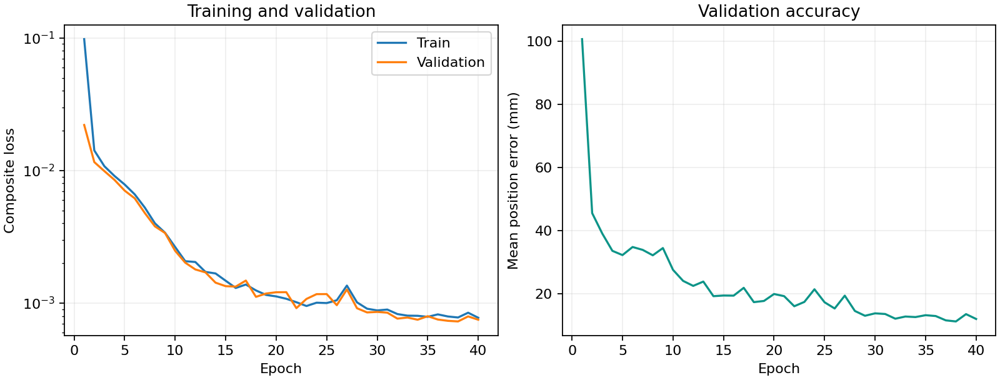
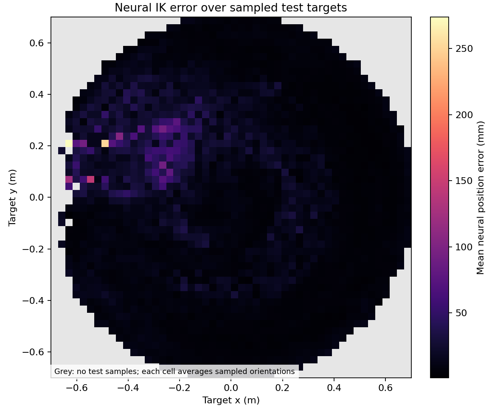

# neural-ik

Learn inverse kinematics for a three-joint planar robot arm with PyTorch, then compare a learned CPU solver against bounded numerical optimization.

The link lengths are **0.30, 0.25, 0.15 m**, with each relative joint angle restricted to **±150°**. A target pose contains position `(x, y)` in metres and absolute end-effector orientation `phi` in radians, wrapped to `[-pi, pi)`. The Gradio demo displays orientation in degrees.

## Run

Python **3.12**, CPU only. From this directory:

```bash
python -m venv .venv
# Windows PowerShell
.venv\Scripts\Activate.ps1
# Linux/macOS: source .venv/bin/activate
python -m pip install -r requirements.txt
python run_pipeline.py
python app.py
```

The pipeline regenerates 200,000 samples, trains, evaluates, runs pytest, and refreshes the measured results below. Its default training budget is 360 seconds, leaving time for the remaining stages within ten minutes on the measured host. Dependency downloads/installation and the indefinitely running demo server are outside the compute budget. Hardware and dependency download speeds vary; use `python run_pipeline.py --train-seconds 240` for a smaller compute budget. Wall-time stopping can change the number of epochs and the final model on another machine.

The supplied `artifacts/model.pt` is already trained: after installing dependencies, `python app.py` opens the demo at **http://127.0.0.1:7860**. It binds to localhost and disables public sharing. To evaluate it, generate the matching dataset with `python data.py`, then run `python evaluate.py`. Scripts resolve default paths relative to the repo, so they also work when invoked from another directory.

Individual commands:

```bash
python data.py                       # fixed seed 42, 160k / 20k / 20k
python train.py                      # Adam, early stopping, best validation checkpoint
python evaluate.py                   # all-test neural metrics + paired 500-target benchmark
python -m pytest -q
python run_pipeline.py --refresh-readme-only
```

## Approach

`data.py` samples independent uniform joint configurations within the joint limits, computes forward kinematics in NumPy, and uses a fixed seeded permutation for the 80/10/10 split. The split is over configurations; the test distribution follows uniform joint sampling and is **not uniform in Cartesian workspace area**. Every sampled pose is reachable by construction.

`model.py` implements an MLP **3 → 256 → 256 → 256 → 6**, with SiLU hidden activations. Inputs use the mean and standard deviation of the training split only, saved as model buffers. The six outputs are normalized `(sin q1, cos q1, sin q2, cos q2, sin q3, cos q3)` pairs. `atan2` decodes the pairs; joint commands are clamped to ±150°. This representation handles output-angle wrapping. The requested scalar `phi` input still has a seam at ±π.

Training uses differentiable PyTorch forward kinematics and this loss:

```text
mean(||p_pred - p_target||²)
+ 0.01 × mean(1 - cos(phi_pred - phi_target))
+ 0.0001 × mean(1 - cos(q_pred - q_sampled))
+ 0.01 × mean(relu(|q_raw| - joint_limit)²)
```

The first term is position error in metres squared. The orientation term makes the full target pose matter; small circular joint supervision weakly favors sampled angles. The limit term supplies a gradient when raw decoded angles exceed the limits. Inverse kinematics can have multiple valid branches, so matching the original sampled joint labels is not the primary accuracy metric. A single continuous MLP can struggle near branch changes, singularities, joint bounds, and the orientation seam; inspect the measured tail errors rather than assuming exact solutions.

`train.py` uses Adam (initial learning rate 0.002, batch size 2048), reduces learning rate on a validation plateau, and stops after 15 epochs without a validation improvement of at least 1e-6, 160 epochs, or the wall-time budget. The final epoch may be partial when the time cap is reached. The checkpoint always comes from the best validation loss, and the test set is never used to select it. Defaults use two CPU training threads and one inference thread in the benchmark. Fixed seeds and deterministic PyTorch operations make runs repeatable for the same environment and number of epochs; wall-time and cross-platform variations remain.

## Measured results

<!-- RESULTS_START -->
Measured on **500 identical test targets** (selection seed 2026); all times are warmed-up, sequential CPU solves with batch size one.

| Solver | Mean position (mm) | Median (mm) | 95th percentile (mm) | Mean orientation (°) | Mean solve (ms) |
|:--|--:|--:|--:|--:|--:|
| Neural MLP | 10.720 | 6.182 | 37.400 | 6.416 | 1.080 |
| SciPy least squares | 0.865 | 0.000 | 0.000 | 0.628 | 12.137 |

On **all 20,000 test samples**, the neural mean / median / 95th-percentile position errors are **11.206 / 6.303 / 44.167 mm**; mean orientation error is 6.282°. Both solvers have 0.0% / 0.0% joint-limit violations (neural / numerical).

Environment: Python 3.12.3, PyTorch 2.9.0+cpu, NumPy 2.2.6, SciPy 1.16.3; 1 PyTorch inference thread(s). CPU: Intel64 Family 6 Model 78 Stepping 3, GenuineIntel.

Training function: 362.2 seconds, 40 epochs, best validation checkpoint at epoch 38; stopped by wall-time budget. Evaluation function: 8.0 seconds. These function timings exclude process startup and imports; the full pipeline time below includes them.

Complete measured data → training → evaluation → tests run: **459.4 seconds** on CPU (dependencies already installed).
<!-- RESULTS_END -->

The paired table compares identical held-out targets. Neural timings include NumPy-to-Torch conversion, normalization, the MLP, pair decoding, and command bounds; numerical timings include seed construction, all optimizer iterations, and any restarts. Both exclude checkpoint/data loading, warm-up, metrics, and plotting. The numerical baseline is `scipy.optimize.least_squares` with a supplied analytic Jacobian, joint bounds, at most three independent deterministic cold starts and 80 function evaluations per start. It uses position residuals and a circular orientation residual scaled by 0.10 m/rad, with no access to test joint labels or neural outputs. It is a local optimizer and can miss a reachable solution.

The table rounds to three decimal places; very small numerical residuals therefore appear as `0.000`.

Exact measurements, dependency versions, environment, and data/checkpoint hashes are in [`artifacts/metrics.json`](artifacts/metrics.json). The training record is in [`artifacts/history.csv`](artifacts/history.csv), and stopping details are in [`artifacts/training_summary.json`](artifacts/training_summary.json).





The workspace heatmap bins **held-out samples**, averaging their measured neural position errors over sampled orientations. Grey cells contain no test samples. It is not an exhaustive reachability map.

## Demo and files

`app.py` provides x, y, and phi sliders, draws neural and numerical arm poses and orientation arrows, and reports residuals, joint angles, bound compliance, and interactive timings. Some slider combinations are infeasible. A high numerical residual may also be a local optimizer failure; the demo reports that distinction cautiously.

```text
data.py            Seeded dataset and NumPy forward kinematics
model.py           Normalized MLP, angle decoding, differentiable FK and loss
train.py           CPU training, early stopping, CSV log and training plot
baseline.py        Bounded SciPy numerical IK
evaluate.py        Held-out accuracy, paired solve timings and workspace heatmap
app.py             Gradio demo
run_pipeline.py    Reproduce the experiment and refresh this results table
tests/             FK correctness, differentiability and model shapes
.github/workflows/tests.yml   pytest on pushes and pull requests
artifacts/         Checkpoint, measurements, logs and plots
```

The generated dataset is reproducible and ignored by Git. Tests use small synthetic inputs and do not require training or the dataset. The GitHub Actions workflow installs CPU dependencies and runs pytest; it does not train a model on every push.

API references: [PyTorch Adam](https://docs.pytorch.org/docs/stable/generated/torch.optim.Adam.html), [SciPy least_squares](https://docs.scipy.org/doc/scipy/reference/generated/scipy.optimize.least_squares.html), [Gradio Plot](https://www.gradio.app/docs/gradio/plot).
